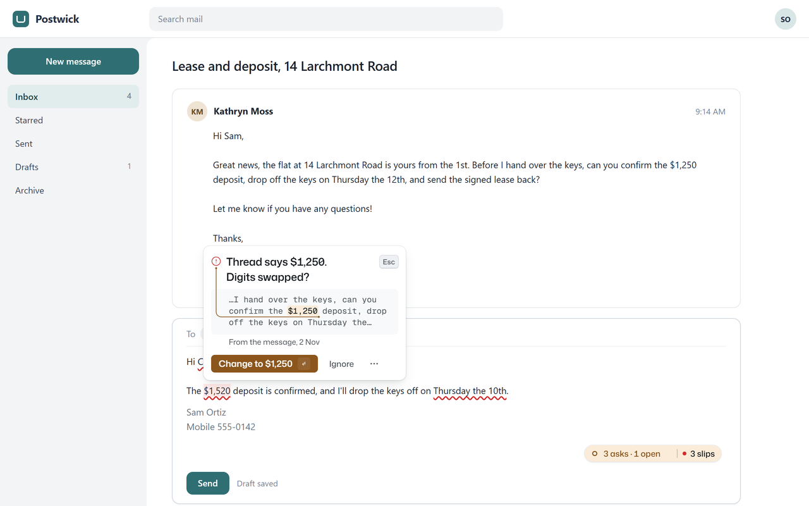
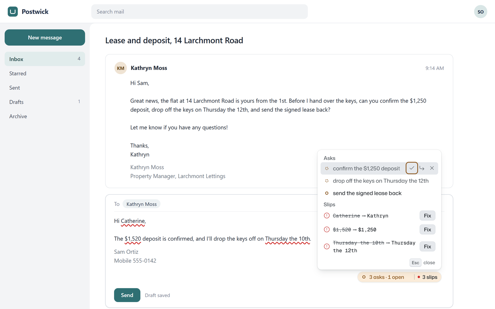

# Readback

**Spellcheck that has read the thread you're replying to.** A browser extension that underlines
the name, amount or date in your reply that nearly matches the message you are answering, and fixes
it in one click. It runs on your device and never blocks Send.

[](https://github.com/NINJA981/readback/actions/workflows/ci.yml)
[](LICENSE)


<sub>The real extension build on a fictional mail client with an invented thread. Not a recording of
live Gmail (see [Limitations](#limitations)).</sub>

## What it catches

Your spellchecker knows how to spell "definitely". It does not know that the person you are
writing to spells her name Kathryn. Readback uses the thread as its dictionary and only speaks up
for near-misses:

| In the thread       | In your reply       | Readback says                                                |
| ------------------- | ------------------- | ------------------------------------------------------------ |
| Signed `Kathryn`    | `Hi Catherine,`     | Signs as Kathryn                                             |
| `$1,250` deposit    | `$1,520`            | Thread says $1,250. Digits swapped?                          |
| Order `#48213`      | `#48218`            | Order #48213 in the thread. One digit differs.               |
| `Thursday the 12th` | `Thursday the 10th` | Thread says Thursday the 12th. (Fixes: the 12th, or Tuesday) |
| (nothing)           | `Thursday the 10th` | The 10th is a Tuesday.                                       |

A different value on purpose stays quiet: `$1,350` against `$1,250` is a counter-offer, `Bob` is a
different person, `Monday the 23rd` is a new date. A small pill also counts the questions and
requests in the latest message that your reply has not covered yet (`3 asks · 1 open`).

|                                                                                                                                   |                                                                                                  |
| --------------------------------------------------------------------------------------------------------------------------------- | ------------------------------------------------------------------------------------------------ |
|  |  |

## Try it without installing

The **web app** runs the same engine in a page: paste a thread and your reply, or load one of six
sample threads. It works on a phone, works offline once loaded, and makes no requests to other
origins.

- Hosted: **https://ninja981.github.io/readback/app/** (published by `.github/workflows/pages.yml`)
- Local: `pnpm --dir site install && pnpm --dir site build && pnpm --dir site preview`, then open
  http://localhost:4173/app/

## Install the extension

There is no store listing yet. Install it unpacked, from a release zip or from source.

**From a release:** download `readback-0.1.0-chrome.zip` or `readback-0.1.0-firefox.zip` from
[Releases](https://github.com/NINJA981/readback/releases) and unzip it.

**From source** (Node 24, pnpm 10):

```sh
git clone https://github.com/NINJA981/readback.git
cd readback
pnpm install
pnpm build            # Chrome:  .output/chrome-mv3
pnpm build:firefox    # Firefox: .output/firefox-mv3
```

**Chrome or Edge (121 or later):** open `chrome://extensions`, turn on **Developer mode**, choose
**Load unpacked** and pick the `chrome-mv3` folder.

**Firefox (140 or later):** open `about:debugging#/runtime/this-firefox`, choose **Load Temporary
Add-on** and pick `manifest.json` in the `firefox-mv3` folder. Temporary add-ons are removed when
Firefox restarts. The Firefox build has not been run yet (see Limitations).

**Use it:** open a reply in Gmail on the web and type. On any other site, select the message you
are answering, right-click and choose **Use as Readback context**, then write in any text box on
that page. Shortcuts: **Alt+Shift+J** opens the next slip with its fix focused, **Alt+Shift+L**
opens the ledger, **Alt+Shift+R** opens the popup.

## How it works

1. **Read the thread.** The Gmail adapter reads the latest message you did not send: sender,
   signature, To and Cc names, the sent date and the text, with quoted history and forwards
   stripped. The generic adapter uses the text you selected instead.
2. **Harvest what can be misspelled.** Names, currency amounts, IDs (order, invoice, booking
   numbers) and proposed dates (parsed with chrono-node against the message's sent date).
3. **Compare each draft token with the harvest, on every keystroke.** Names flag at one or two
   edits or a known variant (Catherine/Kathryn, Steven/Stephen, about 120 pairs). Amounts flag
   only on swapped digits; IDs also on one changed digit. Dates flag a weekday that does not match
   its day, or a near-miss of the thread's date within a week. Counter-offer phrases ("could we
   do", "instead of") and anything that appears verbatim in the thread never fire.
4. **Draw without touching the page.** Squiggles use the CSS Custom Highlight API, so the mail
   page's DOM is never edited; the pill, card and ledger live in one shadow root. A fix goes
   through the editor's own input path, so Ctrl+Z undoes it. Nothing changes without a click or
   Enter.

Every rule is deterministic TypeScript in `src/engine/` with one dependency (chrono-node). There is
no model, no LLM and no server. See [docs/adr/0001-architecture.md](docs/adr/0001-architecture.md).

## Accuracy

Two different measurements, and they disagree, so both are here.

**On real mail** (the honest number). The engine was run on 4,104 public reply and parent pairs:
2,065 from the Enron corpus (CMU, first ~100 MB) and 2,039 from the python-dev (Oct 2018 to Jun 2019) and gcc (Jan to Apr 2025) mailing lists. One person hand-labelled every squiggle. Numbers
below are for this release's engine.

- **False alarms on replies as people actually sent them** (2,735 replies with a name, amount or
  date to check): **2.12 squiggles per 100 replies, of which 1.76 were false alarms**. Name 1.68
  per 100 (1.32 false), number 0.37 (all false), date 0.07 (all false). Squiggle precision is
  **12%** (17% if the 3 unsure cases were real slips). Enron replies drew 3.9 squiggles per 100,
  mailing-list replies 1.0. 7 real slips were found (5 misspelled names, 2 typos).
- **Recall on seeded slips** (a correct value in a real reply changed on purpose): name typos 80
  to 90%, name spelling variants 71%, ID digit swap or one-digit change 95%, wrong weekday, day or
  month in a date 68 to 76%. Too few real amounts were available to give a rate. Slips outside the
  design are not caught: **0 of 312** dropped or extra digits, wrong first letters, wholly wrong
  people and month changes without a weekday.
- **The one-click fix restores the original** for names and IDs, for 80% of wrong weekdays, 3%
  (1 of 39) of wrong day numbers and 0% of wrong months. The date fix also reformats (`Jan 09`
  becomes `Jan 9`).
- **Question pill:** on 40 real inbound messages with 28 hand-labelled questions, precision is
  **0.63** (0.77 without the corpus's lost-character `?` artefacts) and recall 0.96. Footers,
  "call me with questions" and forwarded notes are the false asks.
- **Speed:** p95 per keystroke of 4.0 ms pooled and 4.3 ms on the worst of the 25 longest real
  threads (up to 2,471 words), against a 16 ms budget.

Most false alarms are ordinary words read as names (Canadian/Canada), the writer's own signature
compared with the thread, nicknames of different people (Steve/Steven), and related but different
IDs (issue 37146 vs 37143).

Method and history: first measured on an earlier engine (commit `10eb98f`: 2.41 squiggles and
1.97 false alarms per 100, seeded recall 81 to 100%). This release stops checking quoted text in
the reply (`>` lines, "On ... wrote:" lines, text under an "Original Message" header) and stops
flagging sentence-initial capitals that are not in address position. That removed 8 squiggles (7
false, 1 real misspelling at the start of a sentence) and added 1 false date. Recall fell mostly
because the seeded test edits values wherever they appear in the reply, and many of those sit in
the quoted copy of the thread, which this release no longer reads; some sentence-initial name typos
are also missed now. One labeller, a partial Enron slice and only 7 natural slips, so the benefit
side rests on the seeded tests. The evaluation harness and the downloaded corpora are not part of
this repository.

**On the synthetic test corpus** (`tests/fixtures/threads`, written by the engine's author):
0 flags on 53 deliberate look-alike cases, 34 of 34 labelled slips found, ask precision and recall
1.0 on 64 messages. These are regression gates in `pnpm test`, not a benchmark.

## Privacy

Readback has no server, account, analytics or telemetry. Mail text is read in the page and stays
in the page's memory.

| Data                                                     | Where                                   | Lifetime                   |
| -------------------------------------------------------- | --------------------------------------- | -------------------------- |
| Thread text and your draft                               | Memory of the mail page only            | Until the reply box closes |
| Settings, and words you marked **Never flag** (as typed) | `chrome.storage.local`                  | Until you clear them       |
| Which asks you dismissed, per reply                      | `chrome.storage.session`, as hashed ids | The browser session        |
| Web app text boxes                                       | Page memory and `sessionStorage`        | The tab                    |

How this is checked: an ESLint rule fails the build on `fetch`, `XMLHttpRequest`, `WebSocket`,
`sendBeacon` and `EventSource`; every extension e2e test fails if the browser made a request that
left the machine; and an e2e test reads both storage areas after a reply with slips and asserts that
no thread or draft text is in them (`e2e/gmail.spec.ts`). The extension's CSP is
`script-src 'self'; object-src 'self'`. The web app's CSP sets `connect-src 'none'`.

**Permissions and why:**

| Permission                         | Why                                                                                    |
| ---------------------------------- | -------------------------------------------------------------------------------------- |
| `https://mail.google.com/*` (host) | The only site the content script runs on by itself.                                    |
| `storage`                          | Settings, ignored words, dismissed asks (above).                                       |
| `contextMenus`                     | The "Use as Readback context" menu item.                                               |
| `activeTab`, `scripting`           | Inject the generic adapter into the current tab, only after you choose that menu item. |

## Limitations

- **Never run against live Gmail.** The Gmail adapter was built against hand-made, Gmail-shaped
  fixtures (`tests/fixtures/gmail`), because no Gmail account was available. Its selectors are
  fallback chains with a self-test, and when the self-test fails Readback goes silent and the popup
  offers the select-as-context path. Whether it reads today's Gmail is unverified. Screenshots and
  the demo use a fictional mail client built on the same fixtures.
- **Firefox is built, never run.** Wavy `::highlight` underlines, focus inside shadow roots and
  fonts loaded from bytes are untested there.
- **False alarms are real:** about 1.8 per 100 replies on real mail, more on business mail (above).
  Short names (Tim/Tom) and nicknames of different people are the known weak spots. **Ignore** and
  **Never flag** on the card are the escape hatches.
- **The question pill is weaker than the guards:** 0.63 to 0.77 precision on real mail, below its
  0.90 target.
- **English only.** Names, greetings and dates are read with English rules. In a language that
  capitalises nouns (German), ordinary nouns can be mistaken for names.
- **One reply box at a time:** the first reply or forward on a Gmail page. "Use as Readback context"
  reaches the top frame only, not a reply box inside an iframe. In a plain `<textarea>` the fix
  applies without the swap-back animation.
- **The optional on-device "looks answered" model is not included.** The options page says so; all
  guards and the lexical "looks answered" rule work without it.
- **Not tested by automation:** the real right-click menu and the key chords (the tests send the
  same messages the browser would), real phones and an installed PWA, the frame-exact swap-back
  timeline (SPEC AC-5.4), model timing (AC-7.3), and Lighthouse (AC-W.12, measured by hand once
  before the last design fixes: Accessibility 100 and Best practices 100 on `/` and `/app/`).
- **No store listing** and no trademark check of the name "Readback" yet.

## Development

```sh
pnpm install && pnpm --dir site install
pnpm lint && pnpm typecheck   # ESLint (with the network ban) + Prettier, tsc; both walk site/
pnpm test                     # unit, corpus gates, adapter fixtures (vitest)
pnpm build                    # .output/chrome-mv3, production (closed shadow root)
pnpm test:e2e                 # builds an e2e variant, then Playwright with the extension loaded
pnpm --dir site build && pnpm --dir site test:e2e
pnpm zip && pnpm zip:firefox  # store-ready zips in .output/
```

Spec and acceptance criteria: [SPEC.md](SPEC.md). Test layers and the criterion-to-test matrix:
[docs/TESTING.md](docs/TESTING.md). Visual system: [DESIGN.md](DESIGN.md). Current state and open
work: [HANDOFF.md](HANDOFF.md).

## Contributing

Reports of wrong squiggles are the most useful thing you can send, with invented names and numbers
that still reproduce them. See [CONTRIBUTING.md](CONTRIBUTING.md) for setup, the checks, and how to
add a corpus case, and [SECURITY.md](SECURITY.md) for private security reports. Everyone taking part
follows the [Code of Conduct](CODE_OF_CONDUCT.md).

## License

[MIT](LICENSE). Bundled fonts (Mona Sans, Hubot Sans, Geist Mono) are under the SIL Open Font
License 1.1; see [THIRD_PARTY_NOTICES.md](THIRD_PARTY_NOTICES.md). Every person, company and number
in the examples is invented.
